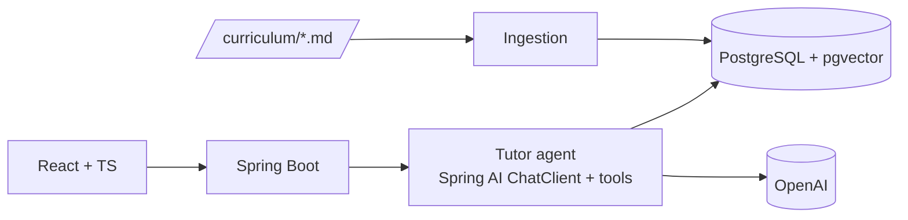

# Lumi English

A study project: **an AI English tutor for absolute beginners** (kids, teens or adults), built with
**Java + Spring Boot**, **React + TypeScript**, **RAG** and an **AI agent with tools**. Runs locally with Docker.

<!-- TODO (Phase 4): GIF here -->

## What it does

- Chats in English at your level (pre-A1 to A2) and adapts its tone to your age group
- Corrects mistakes gently: original → corrected, with a short explanation in Portuguese
- Grounds its explanations in its own curriculum (RAG) and shows the source lesson
- Remembers your mistakes and new words, and brings them back for review (agent tools)
- Voice: speak into the mic and hear the answer
- "Behind the answer" panel: retrieved chunks and tool calls for each reply

## How it works

<!-- TODO: keep in sync with docs/PROJETO.md -->


## Tech stack

Java 21 · Spring Boot 4 · Spring AI 2 · PostgreSQL + pgvector · Flyway · React · TypeScript · Vite · Tailwind ·
JUnit · Testcontainers · Docker Compose

## Running locally

**Requirements:** Docker Desktop, Java 21, Node 22+.

```bash
cp .env.example .env                        # add your OPENAI_API_KEY
docker compose up -d                        # PostgreSQL 17 + pgvector on localhost:5433
cd backend && ./mvnw spring-boot:run        # API on http://localhost:8080
cd frontend && npm install && npm run dev   # UI on http://localhost:5173
```

The backend reads the same `.env` file as Docker Compose, so there is nothing to export. Flyway creates the
schema on startup. Health check: `GET http://localhost:8080/actuator/health`.

Run the tests (needs Docker running; Testcontainers starts its own throwaway database):

```bash
cd backend && ./mvnw verify
```

> Postgres is exposed on **5433** so it doesn't clash with a PostgreSQL installed locally on 5432.
> Change `POSTGRES_PORT` in `.env` if you need another port.

### API

| Method | Path | Description |
|---|---|---|
| `GET` | `/api/settings` | Learner profile (name, age group, level) |
| `PUT` | `/api/settings` | Update the profile. Invalid input returns `400` as [Problem Details](https://www.rfc-editor.org/rfc/rfc9457) |

### Project layout

```
backend/     Spring Boot API (packages by feature under dev.lumi: settings, common, ...)
frontend/    React + TypeScript + Vite + Tailwind
docs/adr/    Architecture decision records
```

## Technical decisions

- [ADR-0001 — PostgreSQL + pgvector](docs/adr/0001-postgres-pgvector.md)
- [ADR-0002 — One agent with tools](docs/adr/0002-single-agent-with-tools.md)

## Evaluation: RAG vs. no RAG

<!-- TODO (Phase 4): numbers from eval/report.md only -->

## Limitations and next steps

Single local user, no authentication, no deployment. Possible next steps: async processing with a message
queue, image input, multi-user support.

## License

MIT
